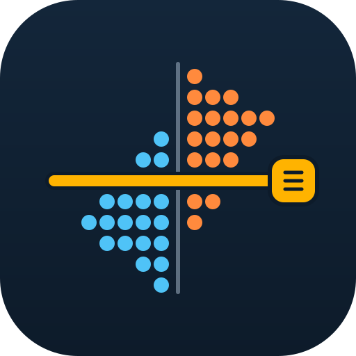
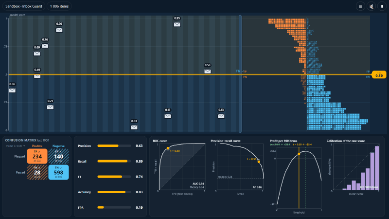
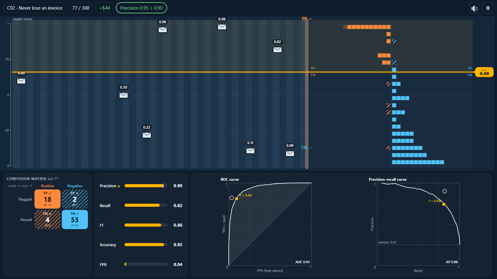

# AI Precision Recall Lab

**A browser game about the metrics of binary classification: draw one line, watch precision, recall and the curves react.**

*[Читать на русском](README_RU.md)* · *[Läs på svenska](README_SV.md)*

Letters, passengers, bolts and card payments ride a conveyor belt at the height of their model score. You drag one **threshold** line: everything at or above it is flagged as positive (spam, fever, crack, fraud), everything below passes. At the gate each item is revealed and falls onto a pile that *is* the **confusion matrix**, and precision, recall, F1, the ROC and the PR curves follow every item. Twelve client contracts with their own prices for mistakes, a Lab of model upgrades, a sandbox and a cheat sheet. In English, Russian and Swedish; on a desktop or a phone, installable as an app.

## What it teaches

- **The confusion matrix** — TP, FP, FN, TN, and why "positive" means "the thing we hunt", not "good".
- **Precision, recall and the threshold seesaw** — raise the line: fewer alarms, precision usually up, recall always down.
- **F1, F-beta, accuracy and its trap**, specificity, FPR, MCC and balanced accuracy.
- **ROC and PR curves**, AUC and average precision — and why PR is the honest one for rare positives.
- **Cost-sensitive thresholds** — the best line comes from the prices of mistakes, not from 0.5.
- **The base rate** — the flu season moves precision while recall stays.
- **Calibration** (Platt scaling), **data drift** (PSI, retraining), a human **review band**, an **adversary** who learns your line, and **top-k retrieval** (precision@k, recall@k) for RAG.

The scores are synthetic (two overlapping normal humps, see [ADR-0002](docs/adr/0002-synthetic-binormal-scores.md)); every formula follows [the spec](docs/spec/02-model-and-metrics.md) and is covered by tests.

## Metrics in one minute

| | Formula | Ask yourself | Remember it as |
|---|---|---|---|
| **Precision** | TP / (TP + FP) | When the model says "yes", how often is it right? | **P**urity of the **P**redicted pile |
| **Recall** | TP / (TP + FN) | Of all the real "yes" cases, how many did it catch? | How much of the **R**eal thing you **R**ounded up |
| **F1** | 2PR / (P + R) | Are both good? | The weakest link: P = 1.0, R = 0.1 → F1 = 0.18, not 0.55 |
| **Accuracy** | (TP + TN) / all | How many decisions were right? | A smoke detector that never beeps is 99.9 % accurate |
| **ROC AUC** | area under TPR against FPR | How well does the model *rank*? | A duel: the chance a random positive outscores a random negative |
| **PR AUC (AP)** | area under precision against recall | How good is it on the rare class? | Its floor is the base rate, not 0.5 |

Matrix: the model's answer in rows, the truth in columns; read the name backwards — FP = said **P**ositive, and that was **F**alse. The full cheat sheet (20 cards) is in the game and in [docs/spec/03-content.md §4](docs/spec/03-content.md#4-cheat-sheet).

## How to play

- **Mouse and keyboard:** drag the threshold handle, or press anywhere on the belt or the pile and drag; the wheel moves the line by 0.01. ↑ / ↓ or W / S move it by 0.01 (Shift: 0.05), Page Up / Page Down by 0.10. In a top-k search the same keys change k. With the review desk, Q / A move the band's lower edge, and a click on an item sends it to people. Esc or P pauses. In menus the arrow keys move between buttons and Space / Enter press the highlighted one.
- **Touch:** put a finger anywhere on the belt or the pile and slide it up or down: the line follows the movement, not the finger, so your thumb never covers the items it is judging. The large handle on the right can be dragged directly; the review band has its own violet handle on the left, and a tap on an item sends it to the review desk. On phones the game goes fullscreen (iPhone Safari stays windowed and still works).
- **Campaign:** you run Cutoff & Co. and take contracts from clients, three acts, twelve contracts. The briefing gives the client's prices for the four outcomes, the goal (e.g. Precision ≥ 0.90 over the whole contract), the model card and a quick question with a bonus. **Stars:** ★ goal met, ★★ also the profit target, ★★★ also 90 % of what the best fixed threshold would have earned on the very same stream. Act 1 teaches the matrix, precision, recall, F1 and costs; Act 2 brings an accuracy trap, a flu season (the base rate shifts), a human review desk and a spam wave (drift, the PSI monitor, Retrain); Act 3 a fraud ring that learns your line, top-k search for an AI assistant, and the big pitch: three clients in a row, each changing its prices halfway.
- **The Lab:** spend the money on more data and better features (the two humps move apart and the AUC grows), calibration, the drift monitor and the review desk.
- **Cheat sheet:** every metric on a card — the formula in the matrix's colours, a mnemonic, a pitfall, an example, a live picture of the pile — plus a "Which metric?" helper. Tap a metric bar twice during play to open its card.
- **Sandbox:** the play screen without money or goals, with knobs for the scenario, the base rate, the separation d′, calibration, prices, a review band and top-k mode; **Generate 1 000** fills the pile at once.
- **Difficulty** (on the start screen and in every retry dialog, remembered): **Easy** — a slower belt, a better model, a faint hint of the true class, the cost-optimal line always shown, softer goals; **Medium** — the contracts as written; **Hard** — a faster belt, a weaker model, stricter goals, no warning before incidents.
- **Language** EN · RU · SV and **Sound** On / Off on the start screen, both remembered. Metric names stay English in every language, with the local term next to them.
- **Cloud save** (optional): **Sign in with Google** on the start screen and the campaign — money, upgrades, stars and bests — syncs between your devices; the settings stay on each device. Without signing in everything stays in the browser.

## Run locally

Open `index.html` in a browser (it works from `file://`), or serve the folder: `python -m http.server` and open http://localhost:8000/ (needed to install it as an app). No build step, no dependencies.

Development (Node 20+): `node --test tests/*.test.js` runs the tests of the simulation; `node tools/balance-check.js` plays every contract headless; the other tools are listed in [AGENTS.md](AGENTS.md#commands).

## Tech notes

- Vanilla JavaScript, Canvas 2D and Web Audio; plain scripts, no framework, no bundler, no third-party code ([ADR-0001](docs/adr/0001-static-vanilla-js.md)) except the optional cloud save's vendored supabase-js ([ADR-0007](docs/adr/0007-cloud-save-supabase.md)); charts drawn by hand ([ADR-0003](docs/adr/0003-hand-drawn-canvas-charts.md)); every sound synthesized.
- A deterministic simulation (`sim/`) with seeded random streams, separated from drawing and sound by an event bus; the same code runs headless in the tests and the balance check.
- An installable PWA on GitHub Pages; a new deploy is picked up only on the start screen or the map, never mid-contract.
- Built with AI coding agents, iteration by iteration: the [spec](docs/spec/00-overview.md), the [roadmap](docs/plan/roadmap.md), the [architecture decisions](docs/adr/README.md) and the [prompt history](docs/prompts/README.md) are all in `docs/`.

## License

[MIT](LICENSE).
