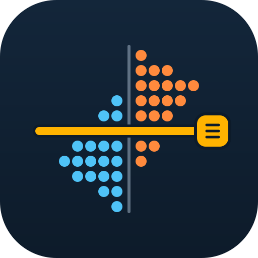
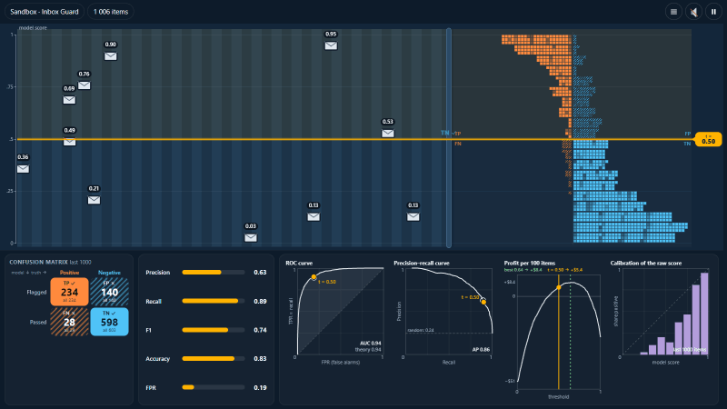
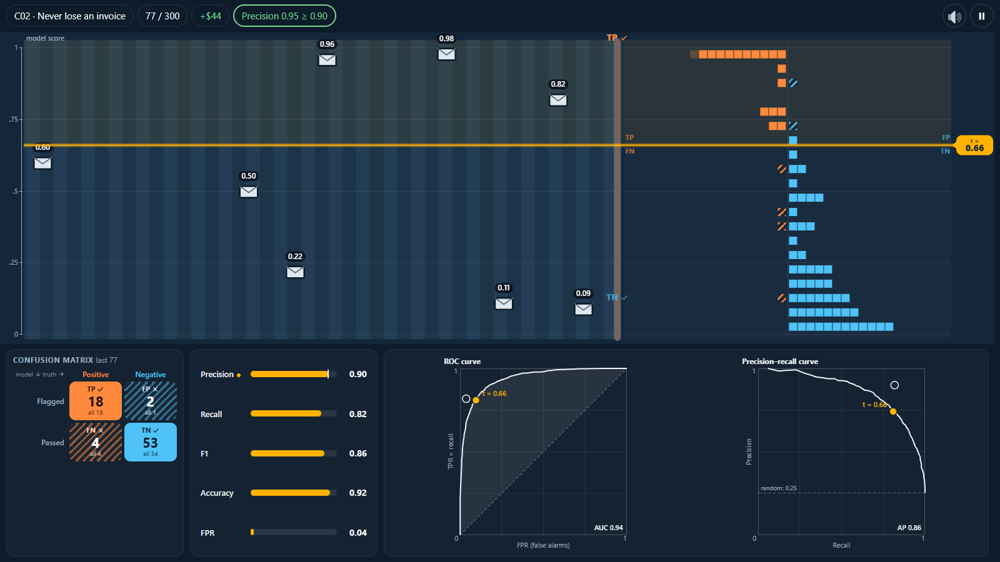

# AI Precision Recall Lab

**Браузерная игра о метриках бинарной классификации: проведите одну линию — и смотрите, как реагируют precision, recall и кривые.**

*[Read in English](README.md)* · *[Läs på svenska](README_SV.md)*

Письма, пассажиры, болты и платежи по картам едут по конвейерной ленте на высоте своего балла модели (score). Вы двигаете одну линию — **порог**: всё, что на ней или выше, помечается как положительное (спам, жар, трещина, мошенничество), всё ниже — пропускается. У ворот каждый предмет раскрывается и падает в кучу, которая и *есть* **матрица ошибок**, а precision, recall, F1, ROC- и PR-кривые меняются с каждым предметом. Двенадцать контрактов с клиентами, у каждого свои цены ошибок, Лаборатория с улучшениями модели, песочница и шпаргалка. На английском, русском и шведском; на компьютере и на телефоне, устанавливается как приложение.

## Чему учит игра

- **Матрица ошибок** — TP, FP, FN, TN, и почему «положительный» значит «то, что мы ищем», а не «хороший».
- **Precision (точность), recall (полнота) и качели порога** — поднимите линию: тревог меньше, precision обычно растёт, recall всегда падает.
- **F1, F-beta, accuracy (доля верных ответов) и её ловушка**, специфичность, FPR, MCC и balanced accuracy.
- **ROC- и PR-кривые**, AUC и average precision — и почему для редкого класса честнее PR.
- **Порог с учётом цены ошибок** — лучшая линия следует из цен ошибок, а не из 0,5.
- **Доля положительного класса** — в сезон гриппа precision сдвигается, а recall остаётся на месте.
- **Калибровка** (Platt scaling), **дрейф данных** (PSI, переобучение), **полоса ручной проверки** людьми, **противник**, который выучивает вашу линию, и **top-k-поиск** (precision@k, recall@k) для RAG.

Баллы синтетические (два перекрывающихся нормальных горба, см. [ADR-0002](docs/adr/0002-synthetic-binormal-scores.md)); каждая формула следует [спецификации](docs/spec/02-model-and-metrics.md) и покрыта тестами.

## Метрики за минуту

Названия метрик в игре остаются английскими — так их пишут в статьях и библиотеках; русский термин стоит рядом. Осторожно: и precision, и accuracy часто переводят как «точность»; здесь «точность» — только precision.

| | Формула | Вопрос | Как запомнить |
|---|---|---|---|
| **Precision** (точность) | TP / (TP + FP) | Когда модель говорит «да», как часто она права? | **P**urity of the **P**redicted pile — чистота кучи помеченных |
| **Recall** (полнота) | TP / (TP + FN) | Сколько из всех настоящих «да» она поймала? | How much of the **R**eal thing you **R**ounded up — какую долю настоящих вы собрали |
| **F1** (F1-мера) | 2PR / (P + R) | Хороши ли обе? | Слабое звено: P = 1,0, R = 0,1 → F1 = 0,18, а не 0,55 |
| **Accuracy** (доля верных ответов) | (TP + TN) / все | Сколько решений верны? | Детектор дыма, который никогда не пищит, верен на 99,9 % |
| **ROC AUC** | площадь под TPR от FPR | Насколько хорошо модель *ранжирует*? | Дуэль: шанс, что случайный положительный получит балл выше случайного отрицательного |
| **PR AUC (AP)** | площадь под precision от recall | Насколько она хороша на редком классе? | Её пол — доля положительного класса, а не 0,5 |

Матрица: ответ модели в строках, правда в столбцах; читайте название с конца — FP = сказала **P**ositive (положительный), и это было **F**alse (неверно). Полная шпаргалка (20 карточек) есть в игре и в [docs/spec/03-content.md §4](docs/spec/03-content.md#4-cheat-sheet).

## Как играть

- **Мышь и клавиатура:** тяните ручку порога или нажмите в любом месте ленты или кучи и тяните; колесо двигает линию на 0,01. ↑ / ↓ или W / S — на 0,01 (с Shift — на 0,05), Page Up / Page Down — на 0,10. В top-k-поиске те же клавиши меняют k. С отделом проверки Q / A двигают нижний край полосы, а щелчок по предмету отправляет его людям. Esc или P — пауза. В меню стрелки переходят между кнопками, Space / Enter нажимают выделенную.
- **Сенсорный экран:** поставьте палец в любом месте ленты или кучи и ведите вверх или вниз: линия следует за движением, а не за пальцем, поэтому большой палец никогда не закрывает предметы, о которых идёт решение. Большую ручку справа можно тянуть напрямую; у полосы проверки своя фиолетовая ручка слева, а касание предмета отправляет его на проверку. На телефонах игра открывается на весь экран (Safari на iPhone остаётся в окне и всё равно работает).
- **Кампания:** вы руководите компанией «Порог и Ко» (Cutoff & Co.) и берёте контракты у клиентов: три акта, двенадцать контрактов. В брифинге — цены клиента за четыре исхода, цель (например, Precision ≥ 0,90 по всему контракту), карточка модели и короткий вопрос с бонусом. **Звёзды:** ★ цель выполнена, ★★ ещё и план по прибыли, ★★★ ещё и 90 % того, что заработал бы лучший фиксированный порог на том же самом потоке. Акт 1 учит матрице, precision, recall, F1 и ценам ошибок; акт 2 приносит ловушку accuracy, сезон гриппа (меняется доля положительного класса), отдел ручной проверки и волну спама (дрейф, монитор PSI, переобучение); акт 3 — кольцо мошенников, которое выучивает вашу линию, top-k-поиск для ИИ-ассистента и большую презентацию: три клиента подряд, и каждый меняет цены на полпути.
- **Лаборатория:** тратьте деньги на больше данных и лучшие признаки (два горба расходятся, AUC растёт), калибровку, монитор дрейфа и отдел проверки.
- **Шпаргалка:** каждая метрика на карточке — формула в цветах матрицы, мнемоника, подвох, пример, живая картинка кучи — и помощник «Какая метрика?». Двойное касание полоски метрики во время игры открывает её карточку.
- **Песочница:** игровой экран без денег и целей, с ручками для сценария, доли положительного класса, разделимости d′, калибровки, цен, полосы проверки и режима top-k; **Создать 1 000** заполняет кучу сразу.
- **Сложность** (на стартовом экране и в каждом окне повтора, запоминается): **Лёгкий** — лента медленнее, модель лучше, слабая подсказка настоящего класса, оптимальная по ценам линия видна всегда, цели мягче; **Средний** — контракты как их написали клиенты; **Сложный** — лента быстрее, модель слабее, цели строже, инциденты без предупреждения.
- **Язык** EN · RU · SV и **Звук** вкл. / выкл. — на стартовом экране, оба запоминаются.
- **Сохранение в облаке** (по желанию): **Войти через Google** на стартовом экране — и кампания (деньги, улучшения, звёзды и рекорды) синхронизируется между вашими устройствами; настройки остаются на каждом устройстве свои. Без входа всё хранится в браузере.

## Запуск локально

Откройте `index.html` в браузере (работает из `file://`) или раздайте папку: `python -m http.server` и откройте http://localhost:8000/ (нужно, чтобы установить как приложение). Без сборки и зависимостей.

Разработка (Node 20+): `node --test tests/*.test.js` запускает тесты симуляции; `node tools/balance-check.js` проигрывает все контракты без браузера; остальные инструменты перечислены в [AGENTS.md](AGENTS.md#commands).

## Технические заметки

- Чистый JavaScript, Canvas 2D и Web Audio; обычные скрипты, без фреймворка, бандлера и стороннего кода ([ADR-0001](docs/adr/0001-static-vanilla-js.md)), кроме вложенной в репозиторий supabase-js для сохранения в облаке ([ADR-0007](docs/adr/0007-cloud-save-supabase.md)); графики нарисованы вручную ([ADR-0003](docs/adr/0003-hand-drawn-canvas-charts.md)); все звуки синтезируются.
- Детерминированная симуляция (`sim/`) с сидированными потоками случайных чисел, отделённая от отрисовки и звука шиной событий; тот же код без браузера работает в тестах и проверке баланса.
- Устанавливаемое PWA на GitHub Pages; новая версия подхватывается только на стартовом экране или на карте, никогда посреди контракта.
- Сделано с ИИ-агентами, итерация за итерацией: [спецификация](docs/spec/00-overview.md), [план](docs/plan/roadmap.md), [архитектурные решения](docs/adr/README.md) и [история промптов](docs/prompts/README.md) лежат в `docs/` (на английском).

## Лицензия

[MIT](LICENSE).
