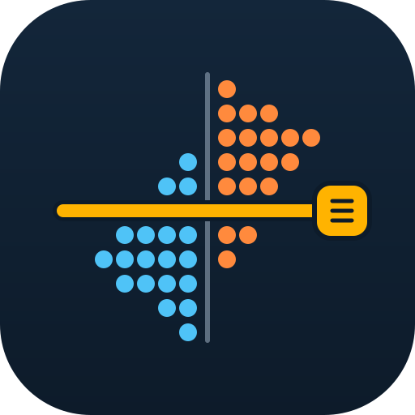
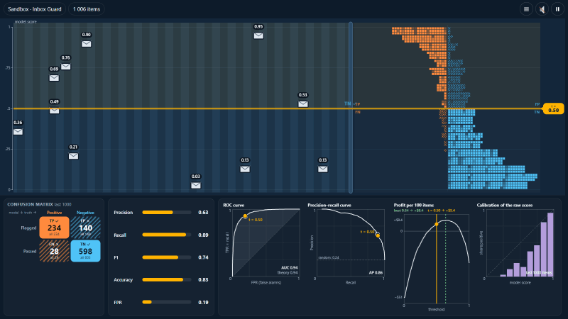
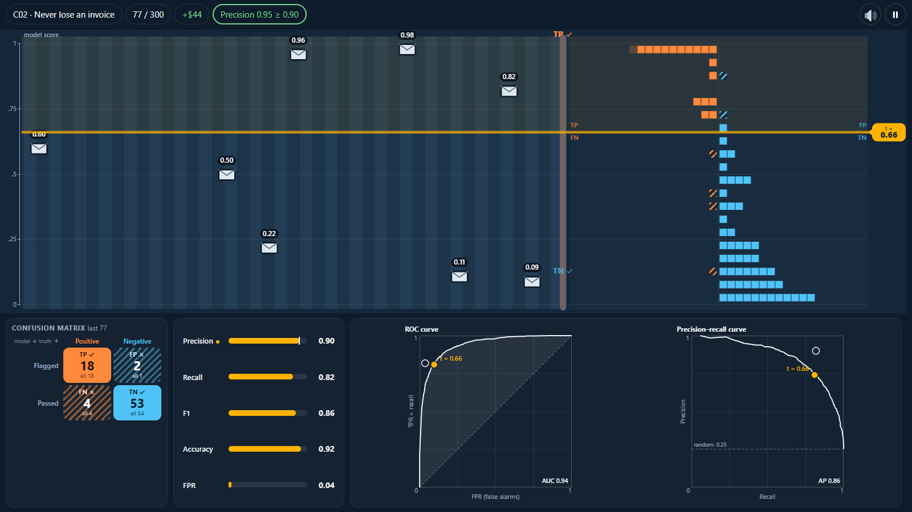

# AI Precision Recall Lab

**Ett webbläsarspel om måtten för binär klassificering: dra en linje och se precision, recall och kurvorna reagera.**

*[Read in English](README.md)* · *[Читать на русском](README_RU.md)*

Brev, passagerare, bultar och kortbetalningar åker på ett transportband på höjden av sin modellpoäng (score). Du drar en enda linje, **tröskeln**: allt på eller över den flaggas som positivt (spam, feber, spricka, bedrägeri), allt under den släpps igenom. Vid grinden avslöjas varje föremål och faller ner i en hög som *är* **förväxlingsmatrisen**, och precision, recall, F1, ROC- och PR-kurvorna följer varje föremål. Tolv kunduppdrag med egna priser på misstag, ett Labb med modelluppgraderingar, en sandlåda och en fusklapp. På engelska, ryska och svenska; på datorn eller i mobilen, installerbart som app.

## Vad spelet lär ut

- **Förväxlingsmatrisen** — TP, FP, FN, TN, och varför ”positiv” betyder ”det vi jagar”, inte ”bra”.
- **Precision, recall (täckning) och tröskelns gungbräda** — höj linjen: färre larm, precision oftast upp, recall alltid ner.
- **F1, F-beta, accuracy (träffsäkerhet) och dess fälla**, specificitet, FPR, MCC och balanced accuracy.
- **ROC- och PR-kurvor**, AUC och average precision — och varför PR är den ärliga för sällsynta positiva.
- **Kostnadskänsliga trösklar** — den bästa linjen kommer från priserna på misstag, inte från 0,5.
- **Basfrekvensen** — influensasäsongen flyttar precision medan recall står still.
- **Kalibrering** (Platt scaling), **datadrift** (PSI, omträning), en **granskningszon** med människor, en **motståndare** som lär sig din linje och **top-k-sökning** (precision@k, recall@k) för RAG.

Poängen är syntetiska (två överlappande normalfördelade pucklar, se [ADR-0002](docs/adr/0002-synthetic-binormal-scores.md)); varje formel följer [specifikationen](docs/spec/02-model-and-metrics.md) och täcks av tester.

## Måtten på en minut

Måttens namn förblir engelska i spelet — så skrivs de i artiklar och bibliotek; den svenska termen står bredvid.

| | Formel | Fråga dig | Kom ihåg det som |
|---|---|---|---|
| **Precision** | TP / (TP + FP) | När modellen säger ”ja”, hur ofta har den rätt? | **P**urity of the **P**redicted pile — hur ren högen av flaggade är |
| **Recall** (täckning) | TP / (TP + FN) | Av alla verkliga ”ja”, hur många fångade den? | How much of the **R**eal thing you **R**ounded up — hur mycket av det verkliga du samlade in |
| **F1** (F1-mått) | 2PR / (P + R) | Är båda bra? | Den svagaste länken: P = 1,0, R = 0,1 → F1 = 0,18, inte 0,55 |
| **Accuracy** (träffsäkerhet) | (TP + TN) / alla | Hur många beslut var rätt? | En brandvarnare som aldrig piper har 99,9 % rätt |
| **ROC AUC** | arean under TPR mot FPR | Hur bra *rangordnar* modellen? | En duell: chansen att en slumpvis positiv får högre poäng än en slumpvis negativ |
| **PR AUC (AP)** | arean under precision mot recall | Hur bra är den på den sällsynta klassen? | Golvet är basfrekvensen, inte 0,5 |

Matrisen: modellens svar i raderna, sanningen i kolumnerna; läs namnet baklänges — FP = sa **P**ositive (positiv), och det var **F**alse (fel). Hela fusklappen (20 kort) finns i spelet och i [docs/spec/03-content.md §4](docs/spec/03-content.md#4-cheat-sheet).

## Så spelar du

- **Mus och tangentbord:** dra tröskelns handtag, eller tryck var som helst på bandet eller högen och dra; scrollhjulet flyttar linjen 0,01. ↑ / ↓ eller W / S flyttar den 0,01 (med Shift 0,05), Page Up / Page Down 0,10. I en top-k-sökning ändrar samma tangenter k. Med granskningsdisken flyttar Q / A zonens nedre kant, och ett klick på ett föremål skickar det till människor. Esc eller P pausar. I menyerna flyttar piltangenterna mellan knapparna och Mellanslag / Enter trycker på den markerade.
- **Pekskärm:** sätt ett finger var som helst på bandet eller högen och dra uppåt eller nedåt: linjen följer rörelsen, inte fingret, så tummen täcker aldrig föremålen den bedömer. Det stora handtaget till höger kan dras direkt; granskningszonen har ett eget lila handtag till vänster, och ett tryck på ett föremål skickar det till granskning. På mobiler går spelet i helskärm (Safari på iPhone stannar i fönster och fungerar ändå).
- **Kampanj:** du driver Cutoff & Co. och tar uppdrag från kunder: tre akter, tolv uppdrag. Genomgången visar kundens priser för de fyra utfallen, målet (t.ex. Precision ≥ 0,90 över hela uppdraget), modellkortet och en snabbfråga med bonus. **Stjärnor:** ★ målet nått, ★★ även vinstmålet, ★★★ även 90 % av vad den bästa fasta tröskeln hade tjänat på exakt samma ström. Akt 1 lär ut matrisen, precision, recall, F1 och kostnader; akt 2 bjuder på en accuracy-fälla, en influensasäsong (basfrekvensen skiftar), en granskningsdisk med människor och en spamvåg (drift, driftvakten med PSI, omträning); akt 3 en bedrägeriliga som lär sig din linje, top-k-sökning för en AI-assistent och den stora pitchen: tre kunder i rad som alla ändrar sina priser halvvägs.
- **Labbet:** lägg pengarna på mer data och bättre särdrag (de två pucklarna glider isär och AUC växer), kalibrering, driftvakten och granskningsdisken.
- **Fusklapp:** varje mått på ett kort — formeln i matrisens färger, en minnesregel, en fallgrop, ett exempel och en levande bild av högen — plus en hjälpare ”Vilket mått?”. Tryck två gånger på en måttstapel under spelet för att öppna dess kort.
- **Sandlåda:** spelskärmen utan pengar och mål, med reglage för scenario, basfrekvens, separationen d′, kalibrering, priser, granskningszon och top-k-läge; **Generera 1 000** fyller högen direkt.
- **Svårighetsgrad** (på startskärmen och i varje försök-igen-dialog, sparas): **Lätt** — långsammare band, bättre modell, en svag ledtråd om den sanna klassen, den kostnadsoptimala linjen alltid synlig, mildare mål; **Medel** — uppdragen som kunderna skrev dem; **Svår** — snabbare band, svagare modell, strängare mål, ingen förvarning före incidenter.
- **Språk** EN · RU · SV och **Ljud** på / av på startskärmen, båda sparas.

## Kör lokalt

Öppna `index.html` i en webbläsare (det fungerar från `file://`), eller servera mappen: `python -m http.server` och öppna http://localhost:8000/ (behövs för att installera som app). Inget byggsteg, inga beroenden.

Utveckling (Node 20+): `node --test tests/*.test.js` kör simuleringens tester; `node tools/balance-check.js` spelar alla uppdrag utan webbläsare; övriga verktyg står i [AGENTS.md](AGENTS.md#commands).

## Tekniska anteckningar

- Ren JavaScript, Canvas 2D och Web Audio; vanliga skript, inget ramverk, ingen bundlare, ingen tredjepartskod ([ADR-0001](docs/adr/0001-static-vanilla-js.md)); diagrammen ritas för hand ([ADR-0003](docs/adr/0003-hand-drawn-canvas-charts.md)); alla ljud syntetiseras.
- En deterministisk simulering (`sim/`) med seedade slumpströmmar, skild från ritning och ljud av en händelsebuss; samma kod körs utan webbläsare i testerna och balanskontrollen.
- En installerbar PWA på GitHub Pages; en ny version plockas upp bara på startskärmen eller kartan, aldrig mitt i ett uppdrag.
- Byggt med AI-kodagenter, iteration för iteration: [specifikationen](docs/spec/00-overview.md), [planen](docs/plan/roadmap.md), [arkitekturbesluten](docs/adr/README.md) och [prompthistoriken](docs/prompts/README.md) finns i `docs/` (på engelska).

## Licens

[MIT](LICENSE).
