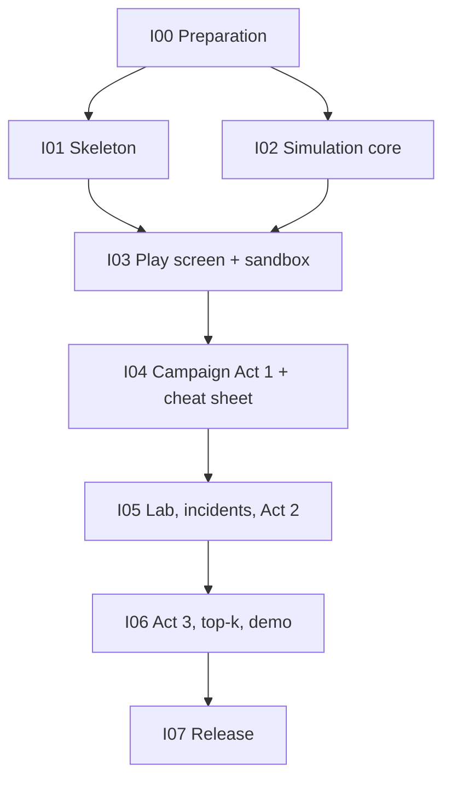

# Roadmap

Work goes in **iterations** (`Ixx`). One iteration = one or more sessions with an AI agent, committed directly to `main` (no feature branches). Each iteration has a plan file in [iterations/](iterations/) with tasks, acceptance criteria and a "Result" section filled in at the end.

Status values: `todo`, `in progress`, `done`, `skipped`. **This table is the single source of truth for status.** Update it when an iteration starts and ends.

## Milestones

| Milestone | Meaning | Iterations |
|---|---|---|
| **M1 Playable sandbox** | The belt, the threshold, the pile, the matrix, metrics and curves work in the sandbox, on desktop and phones | I01–I03 |
| **M2 MVP campaign** | Act 1 (C01–C05) with briefings, results, stars, saving; the cheat sheet | I04 |
| **M3 Full game** | The Lab, incidents, review desk, Acts 2 and 3, top-k, attract demo | I05–I06 |
| **M4 Release** | Sounds, Russian and Swedish, icons, READMEs, screenshot and GIF, GitHub repo and Pages | I07 |

## Iterations

| ID | Iteration | Depends on | Wave | Sessions (est.) | Status |
|---|---|---|---|---|---|
| I00 | [Preparation: game design, spec, plan, conventions](iterations/I00-preparation.md) | — | 0 | 1 | done |
| I01 | [Skeleton: page, tools, i18n, start screen, PWA](iterations/I01-skeleton.md) | I00 | 1 | 1 | todo |
| I02 | [Simulation core: scores, metrics, curves, tests](iterations/I02-simulation-core.md) | I00 | 1 | 1 | todo |
| I03 | [Play screen and sandbox](iterations/I03-play-screen-sandbox.md) | I01, I02 | 2 | 1–2 | todo |
| I04 | [Campaign Act 1 and the cheat sheet](iterations/I04-campaign-act1.md) | I03 | 3 | 2 | todo |
| I05 | [The Lab, incidents, review desk, Act 2](iterations/I05-lab-incidents-act2.md) | I04 | 4 | 2 | todo |
| I06 | [Act 3: adversary, top-k, finale, attract demo](iterations/I06-act3-topk-demo.md) | I05 | 5 | 1–2 | todo |
| I07 | [Release: sounds, translations, icons, READMEs, GitHub Pages](iterations/I07-release.md) | I06 | 6 | 1–2 | todo |

## Dependency graph

## Parallel work

- **Wave 1:** I01 and I02 can run in parallel sessions: I01 owns the page, `styles.css`, `core/` except `utils.js` / `rng.js` / `events.js`, `tools/`, PWA files; I02 owns `sim/`, `core/utils.js`, `core/rng.js`, `core/events.js`, `constants.js` (the 02 §8 block), `data/scenarios.js`, `tests/`. `index.html`'s script list is the one shared file: the second session to commit merges it.
- Everything else is sequential: each iteration builds on the screens of the previous one.

## Rules for every iteration

- Spec first: if the plan or the spec turns out wrong, update the doc in the same change.
- Every text the player sees goes through `tr()`. The game is English only until I07 (owner's decision); from I07 on every text also gets its RU and SV entries in the same change (`node tools/i18n-check.js .`).
- The GitHub repo and Pages come at the end (I07); until then everything stays local.
- `node --test tests/` green; `?v=N` bumped for every changed CSS/JS file; a short browser check with `tools/cdp.js` (phone and desktop) for UI changes.
